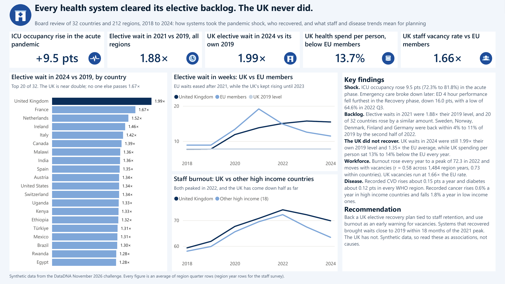
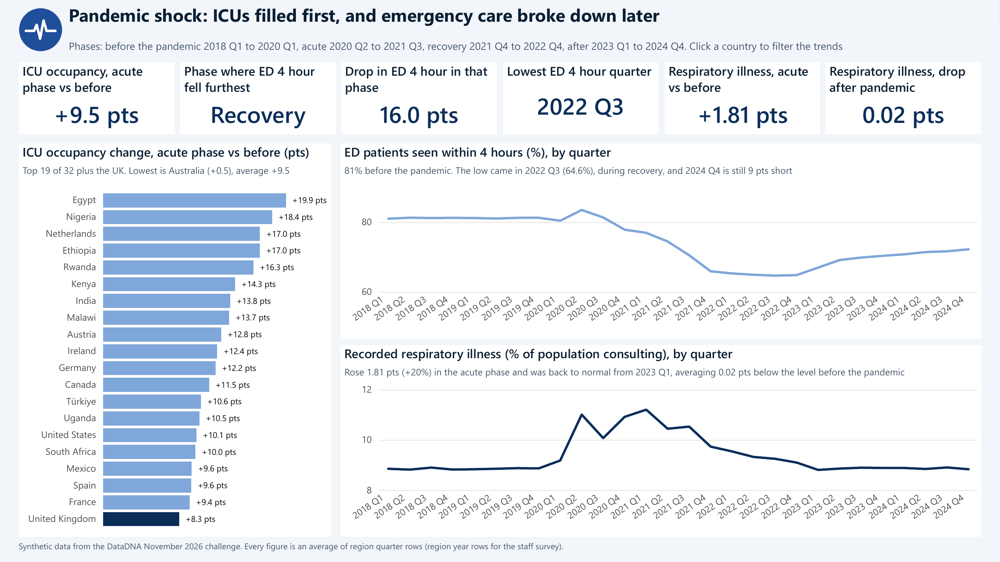
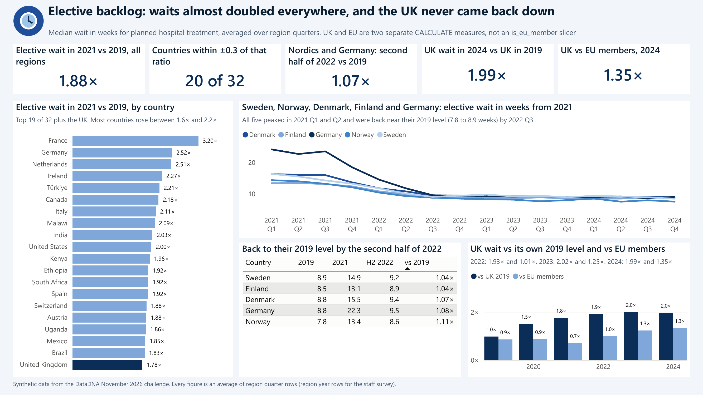
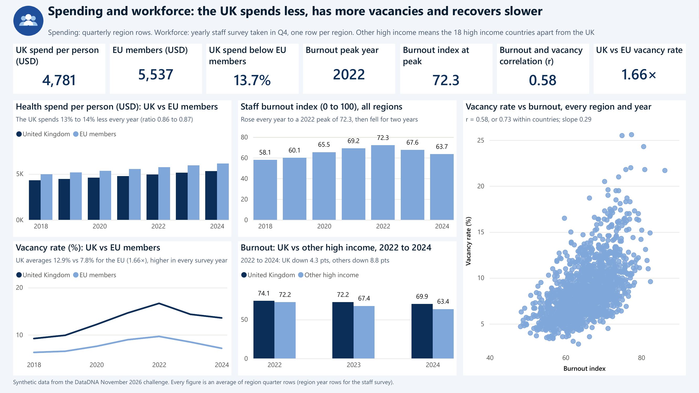
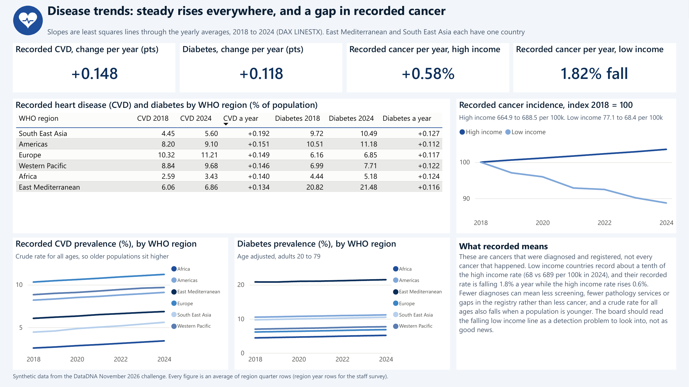
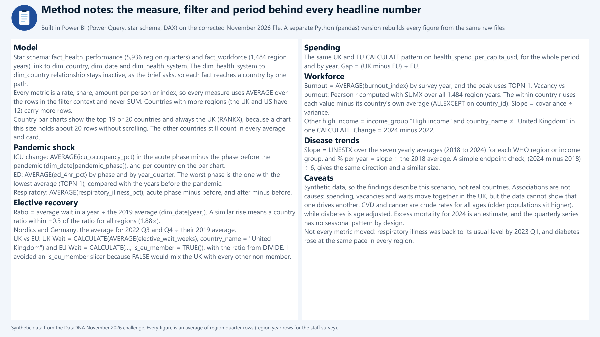
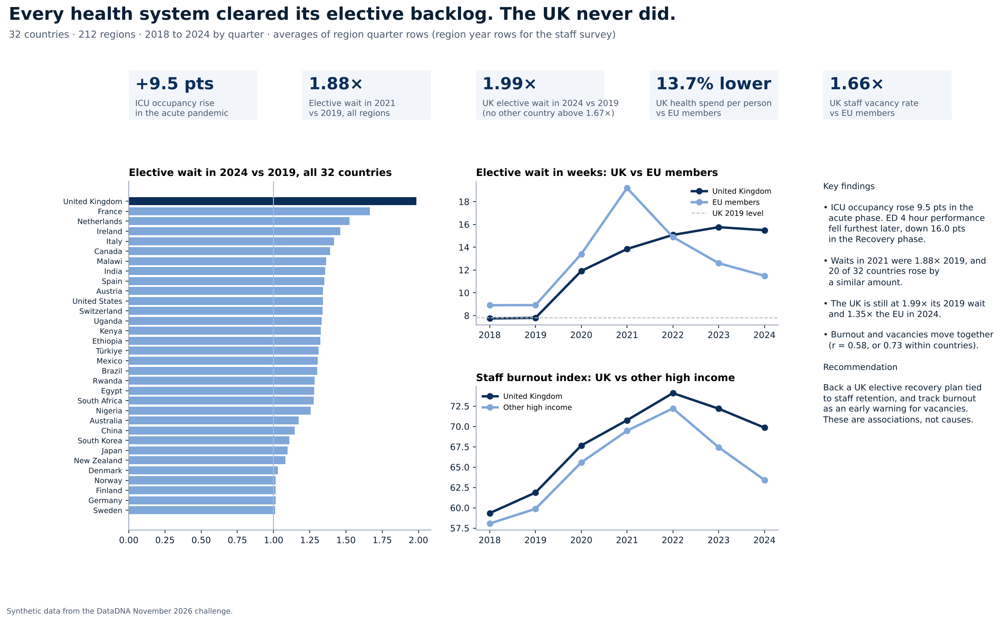

# Health System Performance: every system cleared its elective backlog except the UK's

**DataDNA November 2026 challenge (Onyx Data) · 32 countries · 212 regional health systems · 2018 to 2024 by quarter**

I built this project twice from the same raw files. The main version is a **Power BI** report (Power Query, a star schema and 76 DAX measures). The second is a **Python** version (pandas, NumPy, matplotlib) that works out every headline number again and gets the same answer.

*Synthetic data from the DataDNA November 2026 challenge.*

## The brief

A policy unit's board wants to know how health systems coped with the pandemic, who recovered, and what workforce and disease trends mean for planning. The brief names five areas, and each one has its own page in the report.

## What I found

| Area | Finding | How I measured it |
|---|---|---|
| **Pandemic shock** | ICU occupancy rose **9.5 pts** (72.3% to 81.8%) in the acute phase. Emergency care broke down *later*: ED 4 hour performance fell furthest in the **Recovery** phase, down **16.0 pts**, with its low of **64.6% in 2022 Q3**. Respiratory illness rose 1.81 pts and was back to normal by 2023 Q1. | averages by pandemic phase and by quarter |
| **Elective backlog** | The average wait in 2021 was **1.88×** its 2019 level, and **20 of 32** countries were within 0.3 of that. Sweden, Norway, Denmark, Finland and Germany were back to **1.07×** their 2019 level by the second half of 2022. **The UK was still at 1.99× its 2019 wait in 2024**, when no other country was above 1.67×, and at **1.35× the EU average**. | ratio of yearly averages, with the UK and the EU as two separate filters |
| **Spending** | UK health spend per person was **$4,781 against $5,537** for EU members, **13.7% lower**, and 13% to 14% lower in every single year. | the same UK and EU pattern on spend per person |
| **Workforce** | Staff burnout rose every year to a **peak of 72.3 in 2022**. Burnout and vacancies move together (**r = 0.58** across 1,484 region years, **0.73 within countries**). UK vacancies are **1.66×** the EU rate, and UK burnout fell only 4.3 pts from 2022 to 2024, against 8.8 pts for other high income countries. | Pearson r in DAX with SUMX, and a within country r on values centred on each country's average |
| **Disease trends** | Recorded heart disease (CVD) rises **about 0.15 pts a year** and diabetes **about 0.12 pts** in every WHO region. Recorded cancer rises **0.6% a year** in high income countries and **falls 1.8% a year** in low income ones. That looks like a gap in detection, not good news. | least squares slope through the yearly averages (DAX LINESTX) |

**Recommendation:** back a UK elective recovery plan tied to staff retention, and track burnout as an early warning for vacancies. The systems that recovered brought waits close to 2019 within 18 months of the 2021 peak. The UK has not. *Synthetic data, so these are associations, not causes.*

## The Power BI report (6 pages)

| Page | What's on it |
|---|---|
|  **Executive Summary** | five KPI cards, elective wait in 2024 vs 2019 by country (UK in dark blue), UK vs EU waits, UK vs other high income burnout, key findings and the recommendation |
|  **Pandemic Shock** | ICU change by country, ED 4 hour performance and respiratory illness by quarter; click a country to filter the trends |
|  **Elective Recovery** | 2021 vs 2019 by country, the Nordics and Germany recovering, and the UK against its own 2019 level and against the EU |
|  **Spending and Workforce** | UK vs EU spend, burnout by year, vacancies against burnout for all 1,484 region years, UK vs EU vacancies |
|  **Disease Trends** | CVD and diabetes slopes by WHO region, recorded cancer by income group, and what "recorded" really means |
|  **Method Notes** | the measure, filter and period behind every headline number, plus the caveats |

**Model:** `fact_health_performance` (5,936 region quarters) and `fact_workforce` (1,484 region years) link to `dim_country`, `dim_date` and `dim_health_system`. The `dim_health_system` to `dim_country` relationship stays **inactive**, as the brief asks, so each fact reaches a country by one path. Everything loads through Power Query with one `DataFolder` parameter.

**DAX highlights** (`dax_measures.dax`, 76 measures):
• every metric is a rate, share or index, so every measure uses `AVERAGE` and never `SUM`;  
• UK vs EU is two `CALCULATE` measures (`country_name = "United Kingdom"` and `is_eu_member = TRUE()`). I avoided an `is_eu_member` slicer, because FALSE would lump the UK in with every other country outside the EU;  
• trend slopes with `LINESTX` over yearly averages, Pearson r with `SUMX`, and the within country r with `ALLEXCEPT`;  
• worst phase, lowest quarter and peak year with `TOPN`;  
• the country bar charts use `RANKX` to show the top 19 or 20 countries and always the UK, because a chart that size holds about 20 rows without a scrollbar (the Python dashboard shows all 32);  
• bar colours come from a measure so the UK stands out, with a blue theme and my own icons.

## The Python version

`health_system_analysis.ipynb` (pandas, NumPy, matplotlib):
1. **Checks the raw files first**: row counts (32, 28, 212, 5,936 and 1,484), unique keys, every fact row matching a country, date and system, no missing values, workforce rows in Q4 only, percentages between 0 and 100, and an MD5 checksum for each file. Nothing is edited, filtered or filled in.
2. Uses **the same definitions** as the DAX measures, section by section, with blue charts (`python_01` to `python_04`) and a one page matplotlib dashboard (`python_00_dashboard.png`).
3. Ends with a **reconciliation table**: 22 headline figures read from the Power BI report next to the Python result, rounded the same way. **All 22 match.**

## Files

| File | What it is |
|---|---|
| `DataDNA Nov 2026 Health System Performance.pbix` | the Power BI report, with the data included |
| `page1` to `page6` images and `Health System Performance.pdf` | each report page as an image, and the PDF export |
| `dax_measures.dax` · `theme.json` | all 76 measures as text · the blue report theme |
| `health_system_analysis.ipynb` (and `.py`) | the Python version, with outputs |
| `python_00_dashboard.png` to `python_04_disease_trends.png` | charts from the notebook |
| `linkedin_post.md` | my challenge entry write up |

**Data:** the five CSVs (`dim_country`, `dim_date`, `dim_health_system`, `fact_health_performance`, `fact_workforce`) come from the DataDNA November 2026 challenge pack (the corrected file). I haven't included them here. Download them from the challenge page, then put them next to the notebook, or point the report's `DataFolder` parameter at them (Transform data, then Edit parameters, then Refresh).

## Caveats

The data is synthetic, so the findings describe this scenario, not real countries. Associations are not causes. CVD and cancer are crude rates for all ages, so older populations sit higher, while diabetes is age adjusted. Countries with more regions (the UK and the US have 12 each) carry more rows in every average.

## About

**Bamidele (Ideraoluwa) Yetunde**, Data Analyst (SQL · Power BI · DAX · Power Query · Excel · Python). Open to remote Data Analyst and BI Analyst roles.
